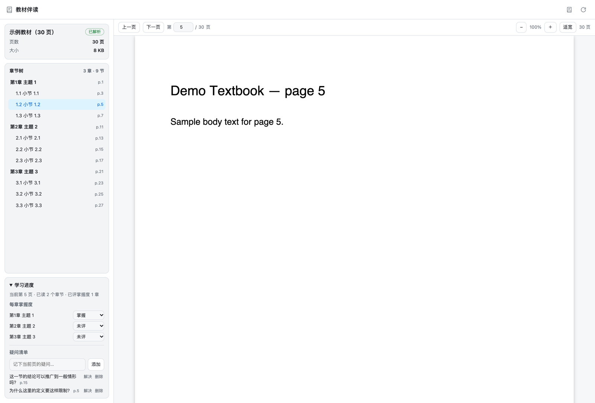
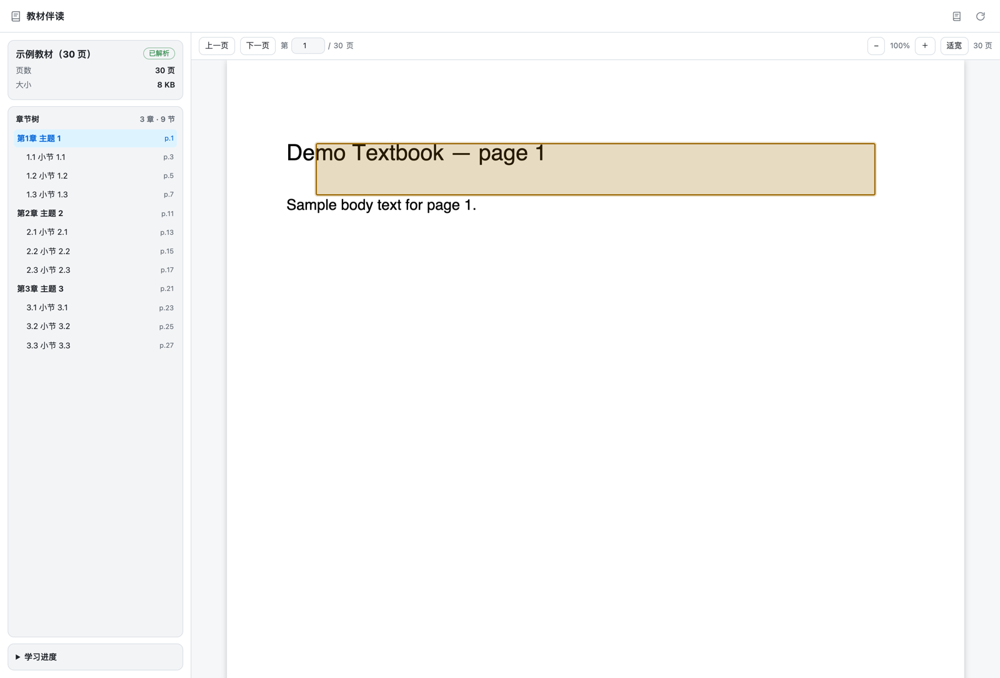
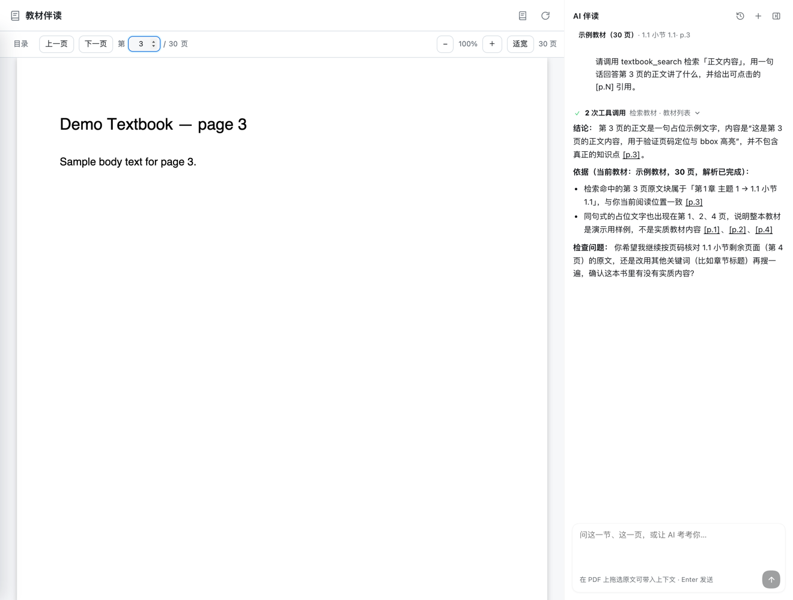

# dsh-textbook-reader

[](https://github.com/richardyang92/dsh-textbook-reader/actions/workflows/ci.yml)
[](LICENSE)
[](https://nodejs.org/)
[](https://github.com/deepseek-ai)

**教材伴读 / Textbook Reader** — 把一本 PDF 教材变成可检索、可引用、能记住学习进度的阅读工作台。

A DeepSeek Harness (DSH) plugin that turns a PDF textbook into a citable reading workspace:
MinerU-parsed chapter tree, a bundled pdf.js reader, page-anchored `[p.N]` citations,
PDF text selection, and cross-session learning progress — all stored locally.



## 功能

| 能力 | 说明 |
|---|---|
| PDF 书架 | 上传或按路径导入 PDF，SHA-256 去重，支持 Range 流式读取 |
| MinerU 解析 | 调用 MinerU v4 `model_version=vlm`，自动发现 zip 内的 `content_list` / `layout` / 图片 |
| 三级章节树 | 自动生成「书 → 章 → 节」，支持改名、合并、升降级纠错 |
| 页锚定引用 | 回答带可点击 `[p.N]`，点击切到阅读器、跳到页码并按 bbox 高亮原文块 |
| 原文选区 | 在 PDF 上拖选文本（扫描版也可，文本层来自 MinerU 解析块），带入右侧聊天提问 |
| 学习进度 | 当前页、已读章节、每章 0–5 掌握度自评、疑问清单；重启与跨会话不丢 |
| 伴读聊天 | 每本教材一个真正的 DSH 子会话，统一放在「教材伴读」工作区，历史随书保存 |
| 工具摘要 | 工具调用默认折叠为一行中文摘要，点开查看每次调用；摘要随对话历史持久化 |
| 大书支持 | 单任务超过 200 页时用 `pdf-lib` 本地分段，合并页号；服务端报更小上限时自动二分重试 |
| 失败可诊断 | 无 token、网络、超时、坏 zip、MinerU 错误码都映射为结构化错误，不静默成功 |



## 工作原理

```text
┌──────────────────────── DeepSeek Harness ────────────────────────┐
│  agent 会话 ── textbook_* 工具 ──┐                               │
│                                  ▼                               │
│  侧栏「教材伴读」 ── 主面板 iframe ── /textbook-reader/          │
│                                  │                               │
│                         local JSON + PDF store                    │
│                         ~/.dsh/textbook-reader/                   │
└──────────────────────────────────┼───────────────────────────────┘
                                   │ 仅解析时
                                   ▼
                         MinerU v4 cloud API
```

- **宿主半**：Cordis 插件，注册 `/textbook-reader` 路由、`textbook_*` agent 工具和伴读会话服务；
- **浏览器半**：React 插件，在官方侧栏加一个入口，用 iframe 承载独立阅读器，默认不修改官方界面；
- **阅读器**：本地 vendored pdf.js，懒渲染页面，叠加 MinerU bbox 文本层与高亮层。

## 快速开始

### 环境要求

- Node.js ≥ 22
- pnpm 11（`packageManager` 固定为 pnpm 11.22.0）
- DeepSeek Harness 0.2.x（桌面端或 `dsh web`）
- 一个 [MinerU](https://mineru.net/) API token（解析 PDF 时需要）

### 从源码安装

```bash
git clone https://github.com/richardyang92/dsh-textbook-reader.git
cd dsh-textbook-reader
pnpm install
pnpm build
```

**桌面端**：打开 DSH →「插件」→「添加插件」→ 填入本目录绝对路径 → 启用 → 重启 DSH。

**Web profile**：

```bash
dsh plugin --profile web add "file:/absolute/path/to/dsh-textbook-reader"
dsh --profile web
```

请使用 `file:`，不要用 `link:`：`link:` 不会安装插件依赖，宿主启动时可能找不到运行时依赖。源码更新后先执行 `pnpm build`；若包管理器提示 `Already up to date`，在插件管理页卸载后重装。

### 配置 MinerU token

在阅读器里展开「MinerU 设置」并保存 token。token 只写入本机：

```text
~/.dsh/textbook-reader/mineru-token   # 0600
~/.dsh/textbook-reader/               # 0700
```

界面与 API 只返回掩码（末 4 位），不会回传明文，也不会写日志。测试或便携场景可用
`TEXTBOOK_READER_DATA_DIR` 覆盖数据目录。

### 开始阅读

1. 侧栏点「教材伴读」→「上传 PDF」；
2. 在设置里保存 token →「开始解析」，等待解析完成；
3. 打开伴读聊天提问，回答中的 `[p.N]` 可点击跳回并高亮；
4. 在 PDF 上拖选原文 →「问 AI」，或直接在进度侧栏记录掌握度与疑问。

> 未解析的书仍可正常翻阅；解析完成后才提供章节树、检索、选区与引用高亮。

## Agent 工具

| 工具 | 用途 |
|---|---|
| `textbook_add` | 按绝对路径把 PDF 加入书架（不解析） |
| `textbook_list` | 列出教材、当前书、解析状态与进度摘要 |
| `textbook_parse` | 提交 MinerU 异步解析，可强制重新解析 |
| `textbook_tree` | 读取章/节树与解析状态 |
| `textbook_search` | 检索原文块，返回 `page` / `blockId` / `bbox` / `citationUrl` |
| `textbook_progress` | 读取当前页、已读章节、掌握度、疑问 |
| `textbook_progress_update` | 更新当前页、已读章节、掌握度、疑问 |

所有涉及教材内容的回答都必须带回真实页码的 `[p.N]` 链接；引用链接由工具返回的
`readerUrl` / `citationUrl` 拼接，不允许编造页码。



## 数据与隐私

- 数据只存本机 `~/.dsh/textbook-reader/`，不提交 token、模型缓存或真实解析产物；
- MinerU token 使用独立 `0600` 文件，API 只返回掩码；
- 只向 MinerU 官方接口及其签名 CDN 发起解析请求；图注 VLM 默认关闭，不产生额外图片外发；
- 解析结果的下载/上传 URL 会做 SSRF 校验，拒绝非 HTTPS、localhost 与私网地址；
- 仓库内所有示例与截图均来自生成的 fixture，不包含真实教材内容或个人数据。

安全问题请按 [SECURITY.md](SECURITY.md) 私下报告，不要公开贴 token 或教材内容。

## 开发

```bash
pnpm install
pnpm build       # 宿主 dist/ + 浏览器半 lib/ + 阅读器 reader/assets/
pnpm typecheck   # 两个 tsconfig
pnpm test        # 65 项 node:test（会先构建）
```

### 不装插件先看 UI

```bash
pnpm build
node scripts/seed-m2-demo.mjs --data test/.tmp/demo --fresh
node scripts/dev-server.mjs --data test/.tmp/demo --port 52000
# 打开 http://127.0.0.1:52000/textbook-reader/
```

seeder 使用假 MinerU 客户端和内存 fixture，不发网络请求，可用来验证书架、章节树、
掌握度、疑问与页码高亮。

### 真实 MinerU 校准

```bash
pnpm probe:mineru --pdf /path/to/one-page.pdf
```

脚本只输出脱敏结构（状态、zip 条目名、JSON 顶层字段、bbox 样例），不打印 token、
Authorization 或签名 URL；会消耗少量 MinerU 页额度。

## 项目结构

```text
src/            宿主半（Cordis 插件、路由、存储、MinerU、工具、聊天）
src/client/     浏览器半（侧栏入口 + 主面板 iframe）
src/reader/     独立 pdf.js 阅读器
reader/         阅读器静态页面与 vendored pdf.js
scripts/        构建、fixture、MinerU 校准、会话迁移
test/           node:test
docs/           架构、验收、路线图与截图
presets/        预留
```

## 当前限制

- 只支持 PDF；EPUB、多书对照、自动判分、整本翻译不在当前范围；
- 单个 MinerU 任务上限 200 页（API 实测），超过时本地分段；单文件上限 200 MB；
- 真实 MinerU 云 API 的响应结构仍以 `pnpm probe:mineru` 校准为准；仓库内已用 420 页合成
  fixture 覆盖三级树、分段、页码与高亮链路；
- 图注 VLM 是预留开关，默认关闭，当前版本不实现图片外发；
- 章节树重新解析会重建，手动编辑不迁移；
- 桌面端安装由 DSH 桌面应用管理，CLI 无法代装。

更多细节见 [docs/ARCHITECTURE.md](docs/ARCHITECTURE.md)、[docs/ACCEPTANCE.md](docs/ACCEPTANCE.md)
与 [docs/VERIFY-M5.md](docs/VERIFY-M5.md)。

## 参与贡献

欢迎 issue、讨论和 PR。开发约定、测试要求与提交规范见 [CONTRIBUTING.md](CONTRIBUTING.md)。
提交前请确认没有把 token、真实 PDF 或解析产物带进仓库。

## English

`dsh-textbook-reader` is a DeepSeek Harness plugin for reading PDF textbooks with an AI tutor.
It parses books through MinerU, builds an editable book → chapter → section tree, renders pages
with a bundled pdf.js, and makes every answer cite a real page (`[p.N]`) that jumps back and
highlights the source block. It also persists reading progress and supports selecting PDF text
(including scanned pages) as chat context. All data stays under `~/.dsh/textbook-reader/`; the
MinerU token is stored in a `0600` file and never returned by the API.

## 许可

本项目使用 [MIT License](LICENSE)。阅读器内含 Apache-2.0 许可的 pdf.js 及其 wasm/font
组件，许可证随 `reader/vendor/` 分发；第三方组件清单见 [THIRD_PARTY_NOTICES.md](THIRD_PARTY_NOTICES.md)。

---

如果这个插件对你有帮助，欢迎 Star、提 issue，或把它用在你的 DSH 学习工作流里。
